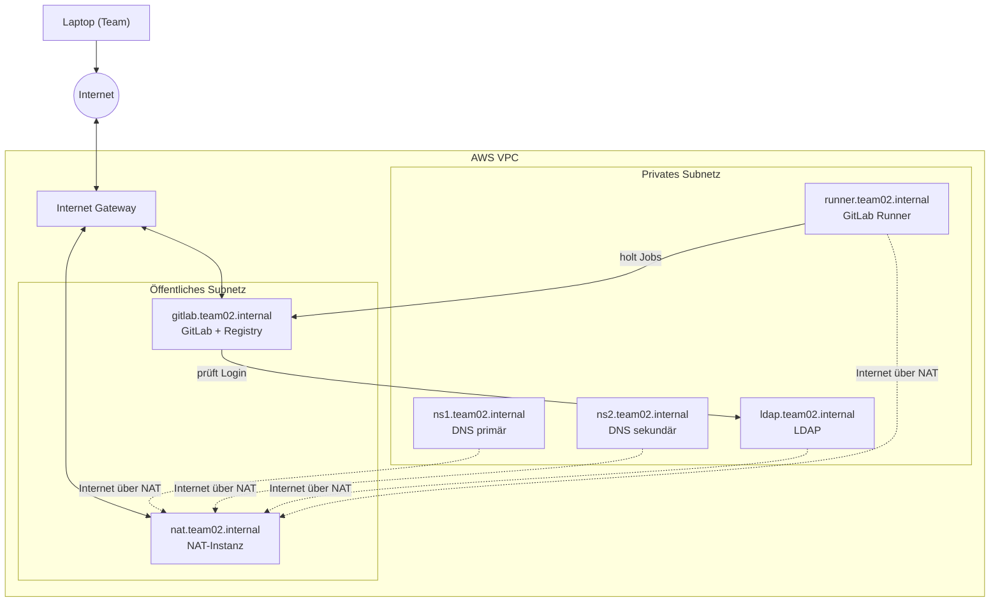

# Infrastructure Specification – Self-hosted CI/CD

**Lehrveranstaltung:** DevOps and Cloud Computing (BIF-DUA-3, WS 2026)
**Team:** Team 02
**Mitglieder:** Kumar Sidhant, Kühlmann Roxana, Jakumov Supjan, Florea Anamaria
**Version:** 0.1  **Stand:** 23.11.2026
---

## Inhaltsverzeichnis

1. Einleitung
2. Netzwerktopologie
3. Security Groups
4. Dienste, Betriebssystem und Software
5. Geplante Tests
6. Softwareprojekt
7. Team, Rollen und Verantwortlichkeiten
8. Änderungshistorie

---

## 1. Einleitung

Ziel des Projekts ist eine selbst gehostete CI/CD-Infrastruktur auf Linux-VMs in einer AWS Virtual Private Cloud (VPC). Sie besteht aus einem primären und einem sekundären DNS-Server, einem GitLab-Server mit Container Registry, einem GitLab Runner und einem LDAP-Server für die zentrale Benutzerverwaltung. Auf dieser Plattform läuft eine CI/CD-Pipeline, die das Softwareprojekt automatisch prüft, baut, testet und als Docker-Image in die GitLab Container Registry ausliefert.

### 1.1 Interner Domain-Name

Als internen Domain-Namen verwenden wir` team02.internal`.
**Begründung:** Die Endung `.internal` ist offiziell für private Netzwerke vorgesehen und wird im Internet nie vergeben. So kann unser Name nicht mit einer echten Website verwechselt werden. Der Name gilt nur innerhalb unserer VPC und wird nur von unseren eigenen DNS-Servern aufgelöst, deshalb müssen wir ihn nicht registrieren. `team02` zeigt, dass die Infrastruktur zu unserem Team gehört.

### 1.2 Überblick über die Server

| Server | FQDN | Dienst |
|---|---|---|
| DNS primär | `ns1.team02.internal` | DNS (Primary) |
| DNS sekundär | `ns2.team02.internal` | DNS (Secondary) |
| GitLab | `gitlab.team02.internal` | GitLab inkl. Container Registry |
| Runner | `runner.team02.internal` | GitLab Runner |
| LDAP | `ldap.team02.internal` | LDAP |
|  NAT-Instanz| ` nat.team02.internal`| NAT für das private Subnetz |

---

## 2. Netzwerktopologie

### 2.1 Subnetz-Aufbau

**Entscheidung:** GitLab läuft in einem öffentlichen Subnetz, DNS, LDAP und Runner in einem privaten Subnetz (Option B2). Die privaten Server erreichen das Internet über eine kleine NAT-Instanz (t3.nano) im öffentlichen Subnetz.

**Alternativen:**
- **Option A:** Alle Server in einem einzigen öffentlichen Subnetz, Schutz nur über Security Groups.
- **Option B1:** Aufbau wie B2, aber mit einem verwalteten NAT Gateway statt NAT-Instanz.

**Begründung:** Im privaten Subnetz sind DNS, LDAP und Runner aus dem Internet grundsätzlich nicht erreichbar. Zusammen mit den Security Groups haben wir damit zwei Schutzschichten statt einer. Ein NAT Gateway kommt nicht in Frage: Es kostet auch ohne Nutzung Geld und lässt sich nicht ausschalten, in acht Wochen wären das allein ca. 60 $, mehr als unser Budget von 50 $. Eine NAT-Instanz wird dagegen wie die anderen Server gestoppt, wenn wir nicht arbeiten, und kostet kaum mehr als Option A. Den höheren Aufwand (NAT-Instanz einrichten, SSH-Zugang über einen Jump Host) nehmen wir für die bessere Sicherheit in Kauf.

**Bekannte Nachteile:** Die NAT-Instanz ist ein Single Point of Failure. Läuft sie nicht, haben die privaten Server keinen Internetzugang (z. B. keine Updates, keine Docker-Images für den Runner).

**Kostenvergleich**

Annahmen: Region us-east-1 · 8 Wochen Projektdauer · Instanzen laufen ca. 80 Stunden und werden danach gestoppt · Instanztypen vorläufig: ns1, ns2, ldap t3.micro, runner t3.small, gitlab t3.medium, NAT-Instanz t3.nano · 62 GB Speicher (plus 8 GB für die NAT-Instanz) · 20 GB Datenverkehr über NAT

| Option | Geschätzte Kosten | Anteil am Budget |
|---|---|---|
| A – ein öffentliches Subnetz | ca. 19 $ | ca. 39 % |
| **B2 – privates Subnetz mit NAT-Instanz** | **ca. 20 $** | **ca. 40 %** |
| B1 – NAT Gateway (dauerhaft) | ca. 86 $ | über Budget |

Preise laut AWS (EC2, EBS, öffentliche IPv4-Adressen, NAT Gateway), berechnet mit dem [AWS Pricing Calculator](https://calculator.aws/).
### 2.2 Adressbereiche

| Element | CIDR | Adressen | Bemerkung |
|---|---|---|---|
| VPC | `10.0.0.0/16` | 10.0.0.0 – 10.0.255.255 | gesamter Adressraum |
| Subnetz öffentlich | `10.0.1.0/24` | 10.0.1.0 – 10.0.1.255 | GitLab, NAT-Instanz |
| Subnetz privat | `10.0.2.0/24` | 10.0.2.0 – 10.0.2.255 | ns1, ns2, LDAP, Runner |

**Region:** us-east-1 (N. Virginia) · **Availability Zone:** us-east-1a (beide Subnetze)

**Begründung:**
- `10.0.0.0/16` ist ein privater Adressbereich und bietet genug Platz für spätere Erweiterungen.
- Jedes Subnetz bekommt einen eigenen `/24`-Bereich. Die Bereiche überschneiden sich nicht, und die dritte Zahl zeigt sofort, in welchem Subnetz ein Server liegt (`10.0.1.x` = öffentlich, `10.0.2.x` = privat).
- Ein `/24`-Subnetz hat 256 Adressen, davon reserviert AWS 5. Für unsere 6 Server ist das mehr als genug.
- Beide Subnetze liegen in derselben Availability Zone. Ausfallsicherheit über mehrere Zonen ist im Projekt nicht gefordert. So bleibt der Aufbau einfach, und es entstehen keine Kosten für Datenverkehr zwischen Zonen.

### 2.3 IP- und Namensplan
> 📝 Issue **#3 – Create IP and hostname plan** 

| FQDN | Private IP | Subnetz | Öffentliche IP |
|---|---|---|---|
| `ns1._____` | _____ | _____ | _____ |
| `ns2._____` | _____ | _____ | _____ |
| `gitlab._____` | _____ | _____ | _____ |
| `runner._____` | _____ | _____ | _____ |
| `ldap._____` | _____ | _____ | _____ |

_Private IPs werden beim Start der Instanzen fest vergeben, damit die DNS-Einträge stabil bleiben._

### 2.4 Öffentliche IP / Elastic IP
> 📝 Issue **#4 – Decide public IP / Elastic IP for GitLab**

**Entscheidung:** _welche Server eine öffentliche IP bekommen, und ob GitLab eine Elastic IP erhält_

**Begründung:** _Erreichbarkeit aus dem Internet, stabile Adresse nach Neustarts, Kosten je öffentlicher IP_

### 2.5 Routing und Namensauflösung
> 📝 Issue **#5 – Describe routing**

| Route Table | Subnetz | Ziel | Gateway |
|---|---|---|---|
| _____ | _____ | _VPC-CIDR_ | local |
| _____ | _____ | `0.0.0.0/0` | Internet Gateway |
| _____ _(nur Option B)_ | _____ | `0.0.0.0/0` | _NAT Gateway / NAT-Instanz_ |

_Beschreibung: welcher Verkehr die VPC verlässt und welcher intern bleibt._

_Namensauflösung: wie alle Server ns1 und ns2 als Nameserver verwenden (z. B. VPC DHCP Options Set)._

### 2.6 Topologie-Diagramm
> 📝 Issue **#6 – Draw network topology diagram**

``

_Das Diagramm zeigt VPC, Subnetze, Internet Gateway, (NAT), Route Tables und alle Instanzen mit privater IP und FQDN._

> 📝 Issue **#7** ist erledigt, wenn die Abschnitte 2.1–2.6 keine Platzhalter mehr enthalten und eine zweite Person sie geprüft hat.

---

## 3. Security Groups

> 📝 **Aufgabe – Milestone „M1: Security groups defined“** · Issue **#8** · Bereich 1, Ports mit den Bereichen 2, 3, 4 abstimmen

**Grundprinzip:** 

**SSH-Zugriff für Admins:** _von welchen IPs, und warum_

### 3.1 Übersicht

| Security Group | Zugeordnete Server |
|---|---|
| _____ | ns1, ns2 |
| _____ | gitlab |
| _____ | runner |
| _____ | ldap |

### 3.2 Regeln je Security Group _(Vorschlag – prüfen)_

**DNS-Server**

| Port | Protokoll | Quelle | Zweck |
|---|---|---|---|
| 53 | UDP | _VPC-CIDR_ | DNS-Anfragen |
| 53 | TCP | _VPC-CIDR_ | DNS-Anfragen und Zone Transfer |
| 22 | TCP | _Admin-IPs_ | SSH-Verwaltung |

**GitLab**

| Port | Protokoll | Quelle | Zweck |
|---|---|---|---|
| 80 / 443 | TCP | _____ | Weboberfläche, Clone/Push über HTTP(S) |
| _____ | TCP | _____ | Container Registry |
| 22 | TCP | _____ | SSH (Verwaltung bzw. Git über SSH) |

**Runner**

| Port | Protokoll | Quelle | Zweck |
|---|---|---|---|
| 22 | TCP | _Admin-IPs_ | SSH-Verwaltung |

_Der Runner baut die Verbindung zu GitLab selbst auf und braucht keine weiteren eingehenden Ports._

**LDAP**

| Port | Protokoll | Quelle | Zweck |
|---|---|---|---|
| 389 | TCP | _Security Group von GitLab_ | LDAP-Anfragen von GitLab |
| 22 | TCP | _Admin-IPs_ | SSH-Verwaltung |

---

## 4. Dienste, Betriebssystem und Software

> 📝 **Aufgabe – Milestone „M1: Services and packages defined“** · Issues #9–#12

### 4.1 Betriebssystem
> 📝 Issue **#9 – Operating system, instance types and service mapping** 

| Eigenschaft | Wert |
|---|---|
| Linux-Distribution und Version | _____ |
| AMI | _____ |

**Begründung:** _____

### 4.2 Mapping der Dienste auf Instanzen
> 📝 Issue **#9** 

| Instanz | Dienste | Instanztyp | vCPU / RAM | Festplatte | Begründung |
|---|---|---|---|---|---|
| ns1 | DNS (Primary) | _____ | _____ | _____ | _____ |
| ns2 | DNS (Secondary) | _____ | _____ | _____ | _____ |
| gitlab | GitLab, Container Registry | _____ | _____ | _____ | _____ |
| runner | GitLab Runner, Docker | _____ | _____ | _____ | _____ |
| ldap | LDAP | _____ | _____ | _____ | _____ |

**Grobe Kostenabschätzung:** _geschätzte Kosten bis Projektende gegenüber dem Budget von 50 $, mit Annahmen_

**Monitoring (optional):** _CloudWatch ja/nein, Begründung_

### 4.3 DNS
> 📝 Issue **#10 – DNS and LDAP software** 

| Eigenschaft | Wert |
|---|---|
| Software und Version | _____ |
| Installationsart | _____ |
| Forward-Zone | _Domain-Name_ |
| Reverse-Zone | _____ |
| Forwarder für externe Namen | _____ |

**Aufbau:** _wie Primary und Secondary zusammenarbeiten (Zone Transfer, Failover)_

**Alternativen:** _____

**Begründung:** _____

### 4.4 GitLab-Server
> 📝 Issue **#11 – GitLab server software**

| Eigenschaft | Wert |
|---|---|
| Edition und Version | _____ |
| Installationsart | _Paket oder Docker_ |
| Container Registry | _Port _____, HTTP/HTTPS_ |

**Begründung:** _____

### 4.5 GitLab Runner
> 📝 Issue **#12 – GitLab Runner software and software project** 

| Eigenschaft | Wert |
|---|---|
| Version | _____ |
| Installationsart | _____ |
| Executor | _____ |
| Bau von Docker-Images | _____ |
| Registrierung | über `gitlab._____` (interner DNS-Name, laut Angabe gefordert) |

**Begründung:** _____

### 4.6 LDAP
> 📝 Issue **#10 – DNS and LDAP software** 

| Eigenschaft | Wert |
|---|---|
| Software und Version | _____ |
| Installationsart | _____ |
| Base DN | _____ |
| Anbindung | GitLab kontaktiert `ldap._____` (interner DNS-Name, laut Angabe gefordert) |

**Begründung:** _____

---

## 5. Geplante Tests

> 📝 **Aufgabe – Milestone „M1: Service checks/tests planned“** · ein Issue pro Bereich _(Nummern nach dem Anlegen eintragen)_
> Vorschläge prüfen, anpassen und konkrete Befehle eintragen.

### 5.1 Netzwerk _(Vorschlag – prüfen)_
> 📝 Issue **#___ – Plan network tests** 

| # | Test | Befehl / Vorgehen | Erwartetes Ergebnis |
|---|---|---|---|
| N1 | Server erreichen sich intern | _z. B. `ping` von runner zu gitlab_ | Antwort erhalten |
| N2 | Interne Dienste von außen gesperrt | Verbindung von außen auf DNS- bzw. LDAP-Port | Verbindung schlägt fehl |
| N3 | GitLab aus dem Internet erreichbar | GitLab-URL im Browser öffnen | Login-Seite erscheint |

### 5.2 DNS _(Vorschlag – prüfen)_
> 📝 Issue **#___ – Plan DNS and LDAP tests** 

| # | Test | Befehl / Vorgehen | Erwartetes Ergebnis |
|---|---|---|---|
| D1 | Forward Lookup | `dig gitlab.<domain> @ns1.<domain>` | Private IP von gitlab |
| D2 | Reverse Lookup | `dig -x <IP von gitlab>` | `gitlab.<domain>` |
| D3 | Lookups von jedem Server | D1 und D2 auf allen Servern | Gleiche Antworten überall |
| D4 | Zone Transfer | Eintrag auf ns1 ändern, Serial erhöhen, dann `dig <name> @ns2.<domain>` | ns2 kennt die Änderung |
| D5 | Failover | ns1 stoppen, dann `dig gitlab.<domain>` | Antwort kommt von ns2 |
| D6 | Externe Namen | `dig www.technikum-wien.at` | Öffentliche IP wird aufgelöst |

### 5.3 LDAP _(Vorschlag – prüfen, Umsetzung in M3)_
> 📝 Issue **#___ – Plan DNS and LDAP tests** 

| # | Test | Befehl / Vorgehen | Erwartetes Ergebnis |
|---|---|---|---|
| L1 | LDAP-Suche | `ldapsearch -x -H ldap://ldap.<domain> -b "<Base DN>"` | Einträge werden aufgelistet |
| L2 | Login in GitLab über LDAP | Anmeldung in GitLab mit LDAP-Benutzer | Login erfolgreich |

### 5.4 GitLab _(Vorschlag – prüfen)_
> 📝 Issue **#___ – Plan GitLab tests** 

| # | Test | Befehl / Vorgehen | Erwartetes Ergebnis |
|---|---|---|---|
| G1 | Login | Anmeldung im Browser | Dashboard erscheint |
| G2 | Repository anlegen | Neues Projekt in der Weboberfläche | Projekt existiert |
| G3 | Clone vom Laptop | `git clone <URL>` | Repo lokal vorhanden |
| G4 | Push vom Laptop | Datei ändern, `git push` | Änderung in GitLab sichtbar |
| G5 | Container Registry | `docker login <Registry-URL>` | Login Succeeded |

### 5.5 Runner _(Vorschlag – prüfen)_
> 📝 Issue **#___ – Plan Runner tests** 

| # | Test | Befehl / Vorgehen | Erwartetes Ergebnis |
|---|---|---|---|
| R1 | Registrierung | Runner über `gitlab.<domain>` registrieren | Runner in GitLab als online sichtbar |
| R2 | Test-Job | Minimale `.gitlab-ci.yml` mit einem `echo`-Job pushen | Job läuft auf dem eigenen Runner und ist grün |

---

## 6. Softwareprojekt

> 📝 **Aufgabe** · Issue **#12 – GitLab Runner software and software project** 

### 6.1 Beschreibung

_Name des Projekts, Zweck, Aufbau (z. B. Schichten), Herkunft (z. B. aus SWEN1). 3–5 Sätze._

### 6.2 Build- und Testanforderungen

| Eigenschaft | Wert |
|---|---|
| Sprache und Version | _____ |
| Build-Tool | _____ |
| Externe Abhängigkeiten | _____ |
| Statische Code-Analyse (Linter) | _____ |
| Unit-Tests | _Framework, Anzahl, laufen sie ohne Datenbank?_ |
| Docker-Image | _____ |
| Laufzeitabhängigkeiten | _____ |

### 6.3 Bedeutung für die Infrastruktur

_z. B. welche Ressourcen der Runner für Build und Tests braucht und warum GitLab eine Container Registry benötigt._

---

## 7. Team, Rollen und Verantwortlichkeiten

> 📝 **Aufgabe** · Issue **#___ – Team roles in specification** · Rollen werden mündlich geklärt

| Bereich | Verantwortlich | Vertretung | Dienste und Aufgaben |
|---|---|---|---|
| 1 – Cloud, Netzwerk & Projektleitung | _____ | _____ | VPC, Subnetze, Routing, Security Groups, Instanzen, Kosten, Gesamtdokumentation, Abgaben |
| 2 – DNS & LDAP | _____ | _____ | DNS Primary und Secondary, Zonen, LDAP |
| 3 – GitLab-Server | _____ | _____ | GitLab, Container Registry, LDAP-Anbindung in GitLab |
| 4 – Runner & CI/CD | _____ | _____ | GitLab Runner, Vorbereitung des Softwareprojekts, CI/CD-Pipeline |

**Projektleitung:** _____

---

## 8. Änderungshistorie

| Version | Datum | Änderung | Autor |
|---|---|---|---|
| 0.1 | 22.11.2026| Gerüst erstellt | Anamaria Florea  |
| 1.0 | _____ | Abgabe M1 | _____ |
