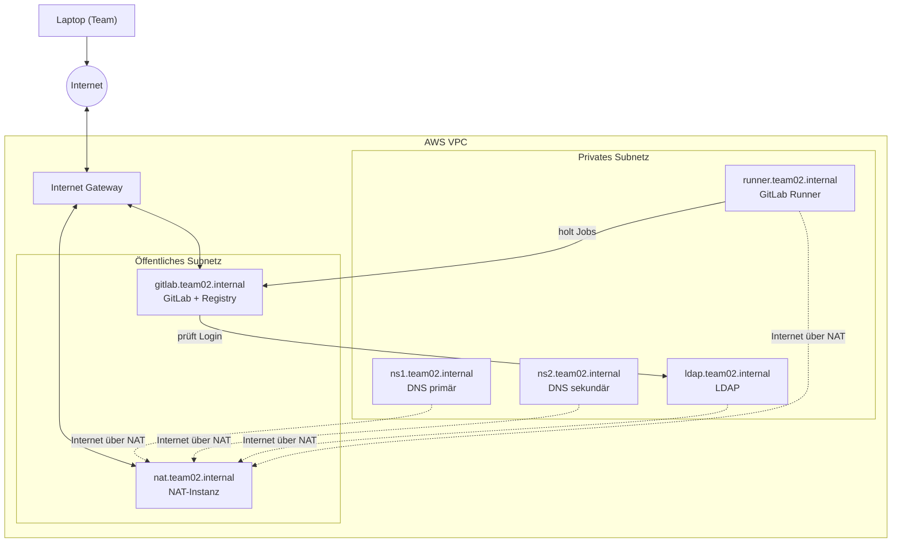
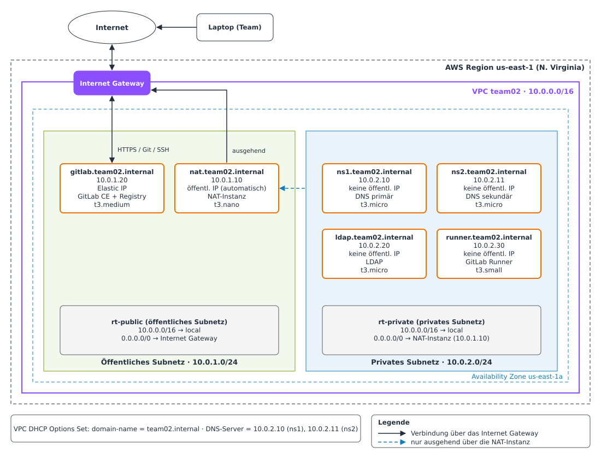

# Infrastructure Specification – Self-hosted CI/CD

**Lehrveranstaltung:** DevOps and Cloud Computing (BIF-DUA-3, WS 2026)
**Team:** Team 02
**Mitglieder:** Kumar Sidhant, Kühlmann Roxana, Jakumov Supjan, Florea Anamaria
**Version:** 0.1  **Stand:** 23.11.2026
---

## Inhaltsverzeichnis

1. Einleitung
2. Netzwerktopologie
3. Security Groups
4. Dienste, Betriebssystem und Software
5. Geplante Tests
6. Softwareprojekt
7. Team, Rollen und Verantwortlichkeiten
8. Änderungshistorie

---

## 1. Einleitung

Ziel des Projekts ist eine selbst gehostete CI/CD-Infrastruktur auf Linux-VMs in einer AWS Virtual Private Cloud (VPC). Sie besteht aus einem primären und einem sekundären DNS-Server, einem GitLab-Server mit Container Registry, einem GitLab Runner und einem LDAP-Server für die zentrale Benutzerverwaltung. Auf dieser Plattform läuft eine CI/CD-Pipeline, die das Softwareprojekt automatisch prüft, baut, testet und als Docker-Image in die GitLab Container Registry ausliefert.

### 1.1 Interner Domain-Name

Als internen Domain-Namen verwenden wir `team02.internal`.

**Begründung:** Die Endung `.internal` ist offiziell für private Netzwerke vorgesehen und wird im Internet nie vergeben. So kann unser Name nicht mit einer echten Website verwechselt werden. Der Name gilt nur innerhalb unserer VPC und wird nur von unseren eigenen DNS-Servern aufgelöst, deshalb müssen wir ihn nicht registrieren. `team02` zeigt, dass die Infrastruktur zu unserem Team gehört.

### 1.2 Überblick über die Server

| Server | FQDN | Dienst |
|---|---|---|
| DNS primär | `ns1.team02.internal` | DNS (Primary) |
| DNS sekundär | `ns2.team02.internal` | DNS (Secondary) |
| GitLab | `gitlab.team02.internal` | GitLab inkl. Container Registry |
| Runner | `runner.team02.internal` | GitLab Runner |
| LDAP | `ldap.team02.internal` | LDAP |
| NAT-Instanz| `nat.team02.internal`| NAT für das private Subnetz |

---

## 2. Netzwerktopologie

### 2.1 Subnetz-Aufbau

**Entscheidung:** GitLab läuft in einem öffentlichen Subnetz, DNS, LDAP und Runner in einem privaten Subnetz (Option B2). Die privaten Server erreichen das Internet über eine kleine NAT-Instanz (t3.nano) im öffentlichen Subnetz.

**Alternativen:**
- **Option A:** Alle Server in einem einzigen öffentlichen Subnetz, Schutz nur über Security Groups.
- **Option B1:** Aufbau wie B2, aber mit einem verwalteten NAT Gateway statt NAT-Instanz.

**Begründung:** Im privaten Subnetz sind DNS, LDAP und Runner aus dem Internet grundsätzlich nicht erreichbar. Zusammen mit den Security Groups haben wir damit zwei Schutzschichten statt einer. Ein NAT Gateway kommt nicht in Frage: Es kostet auch ohne Nutzung Geld und lässt sich nicht ausschalten, in acht Wochen wären das allein ca. 60 \$, mehr als unser Budget von 50 $. Eine NAT-Instanz wird dagegen wie die anderen Server gestoppt, wenn wir nicht arbeiten, und kostet kaum mehr als Option A. Den höheren Aufwand (NAT-Instanz einrichten, SSH-Zugang über einen Jump Host) nehmen wir für die bessere Sicherheit in Kauf.

**Bekannte Nachteile:** Die NAT-Instanz ist ein Single Point of Failure. Läuft sie nicht, haben die privaten Server keinen Internetzugang (zB keine Updates, keine Docker-Images für den Runner).

**Kostenvergleich**

Annahmen: Region us-east-1 · 8 Wochen Projektdauer · Instanzen laufen ca. 80 Stunden und werden danach gestoppt · Instanztypen vorläufig: ns1, ns2, ldap t3.micro, runner t3.small, gitlab t3.medium, NAT-Instanz t3.nano · 62 GB Speicher (plus 8 GB für die NAT-Instanz) · 20 GB Datenverkehr über NAT

| Option | Geschätzte Kosten | Anteil am Budget |
|---|---|---|
| A – ein öffentliches Subnetz | ca. 19 $ | ca. 39 % |
| **B2 – privates Subnetz mit NAT-Instanz** | **ca. 20 $** | **ca. 40 %** |
| B1 – NAT Gateway (dauerhaft) | ca. 86 $ | über Budget |

### 2.2 Adressbereiche

| Element | CIDR | Adressen | Bemerkung |
|---|---|---|---|
| VPC | `10.0.0.0/16` | 10.0.0.0 – 10.0.255.255 | gesamter Adressraum |
| Subnetz öffentlich | `10.0.1.0/24` | 10.0.1.0 – 10.0.1.255 | GitLab, NAT-Instanz |
| Subnetz privat | `10.0.2.0/24` | 10.0.2.0 – 10.0.2.255 | ns1, ns2, LDAP, Runner |

**Region:** us-east-1 (N. Virginia) · **Availability Zone:** us-east-1a (beide Subnetze)

**Begründung:**
- `10.0.0.0/16` ist ein privater Adressbereich und bietet genug Platz für spätere Erweiterungen.
- Jedes Subnetz bekommt einen eigenen `/24`-Bereich. Die Bereiche überschneiden sich nicht, und die dritte Zahl zeigt sofort, in welchem Subnetz ein Server liegt (`10.0.1.x` = öffentlich, `10.0.2.x` = privat).
- Ein `/24`-Subnetz hat 256 Adressen, davon reserviert AWS 5. Für unsere 6 Server ist das mehr als genug.
- Beide Subnetze liegen in derselben Availability Zone. Ausfallsicherheit über mehrere Zonen ist im Projekt nicht gefordert. So bleibt der Aufbau einfach, und es entstehen keine Kosten für Datenverkehr zwischen Zonen.

### 2.3 IP- und Namensplan
| Server | FQDN | Private IP | Subnetz | Öffentliche IP | Instanztyp (vorläufig) |
|---|---|---|---|---|---|
| NAT-Instanz | `nat.team02.internal` | `10.0.1.10` | öffentlich | automatisch | t3.nano |
| GitLab | `gitlab.team02.internal` | `10.0.1.20` | öffentlich | Elastic IP | t3.medium |
| DNS primär | `ns1.team02.internal` | `10.0.2.10` | privat | nein | t3.micro |
| DNS sekundär | `ns2.team02.internal` | `10.0.2.11` | privat | nein | t3.micro |
| LDAP | `ldap.team02.internal` | `10.0.2.20` | privat | nein | t3.micro |
| Runner | `runner.team02.internal` | `10.0.2.30` | privat | nein | t3.small |

**Begründung:**
- Jeder Server bekommt eine **feste private IP**, die beim Start der Instanz eingetragen wird. So bleiben die DNS-Einträge auch nach Neustarts gültig.
- Die dritte Zahl zeigt das Subnetz (`10.0.1.x` öffentlich, `10.0.2.x` privat), die letzte Zahl die Art des Dienstes: `.10`–`.19` Netzwerkdienste (NAT, DNS), `.20` Anwendungsdienste (GitLab, LDAP), `.30` CI/CD (Runner).
- Die ersten vier Adressen und die letzte Adresse jedes Subnetzes reserviert AWS (zB `10.0.1.0`–`10.0.1.3` und `10.0.1.255`). Diese verwenden wir nicht.
- Die Instanztypen sind vorläufig und werden in Abschnitt 4.2 endgültig festgelegt und begründet.

### 2.4 Öffentliche IP / Elastic IP

| Server | Art der öffentlichen IP | Grund |
|---|---|---|
| GitLab | Elastic IP | stabile Adresse für Weboberfläche, Clone und Push |
| ns1, ns2, LDAP, Runner | keine | liegen im privaten Subnetz |
| NAT-Instanz | automatisch zugewiesen | nur für ausgehenden Verkehr, Adresse darf sich ändern |

**Entscheidung:** GitLab erhält eine Elastic IP. Die NAT-Instanz bekommt eine automatisch zugewiesene öffentliche IP. Alle anderen Server haben keine öffentliche IP.

**Begründung:** AWS Academy stoppt die Instanzen am Ende jeder Session. Ohne Elastic IP bekäme GitLab bei jedem Start eine neue Adresse. Dann müssten wir die GitLab-Konfiguration (`external_url`) und die Git-Adressen auf allen Laptops jedes Mal anpassen. Die NAT-Instanz braucht keine feste Adresse, weil sie nur Verbindungen nach außen aufbaut.

**Kosten der öffentlichen IPs** (0,005 $ pro IP und Stunde, Annahmen wie in 2.1)

| IP | Verrechnet | Rechnung | Kosten |
|---|---|---|---|
| Elastic IP (GitLab) | immer, auch wenn die Instanz gestoppt ist | 1.344 h × 0,005 $ | ca. 6,70 $ |
| Automatische IP (NAT-Instanz) | nur während die Instanz läuft | 80 h × 0,005 $ | ca. 0,40 $ |
| **Summe** | | | **ca. 7,10 $** |

Mit der Elastic IP steigen die geschätzten Gesamtkosten von Option B2 von ca. 20 \$ auf ca. 26 $ (ca. 52 % des Budgets). Diesen Aufpreis nehmen wir für eine stabile Adresse in Kauf.

**Kostenoptimierung:**
- Die Elastic IP wird erst beim Aufbau von GitLab in M2 angelegt und nach der Abschlusspräsentation sofort freigegeben.
- Der LDAP-Server wird erst in M3 erstellt, weil LDAP in M2 nicht benötigt wird.
- Instanzen laufen nur während der Arbeit und werden danach gestoppt.
- Am Projektende werden alle Ressourcen (Instanzen, Festplatten, Elastic IP) gelöscht, damit keine weiteren Kosten entstehen.
- Das verbrauchte Budget wird vor jedem Meilenstein im Learner Lab geprüft. Wird es knapp, geben wir die Elastic IP frei und passen die GitLab-Adresse auf den Laptops über die `hosts`-Datei an.

### 2.5 Routing und Namensauflösung

#### Route Tables

| Route Table | Zugeordnetes Subnetz | Ziel | Weiterleitung an | Zweck |
|---|---|---|---|---|
| `rt-public` | öffentlich (`10.0.1.0/24`) | `10.0.0.0/16` | local | Verkehr innerhalb der VPC |
| `rt-public` | öffentlich (`10.0.1.0/24`) | `0.0.0.0/0` | Internet Gateway | Verbindung ins Internet |
| `rt-private` | privat (`10.0.2.0/24`) | `10.0.0.0/16` | local | Verkehr innerhalb der VPC |
| `rt-private` | privat (`10.0.2.0/24`) | `0.0.0.0/0` | NAT-Instanz (`10.0.1.10`) | Internetzugang nur nach außen |

Die Route `local` legt AWS in jeder Route Table automatisch an. Sie sorgt dafür, dass sich alle Server innerhalb der VPC direkt erreichen. Damit die NAT-Instanz Verkehr anderer Server weiterleiten darf, wird bei ihr in AWS der „Source/Destination Check“ ausgeschaltet.

#### Welcher Verkehr bleibt intern, welcher verlässt die VPC

| Verbindung | Weg | Bleibt in der VPC? |
|---|---|---|
| Runner → GitLab (Jobs abholen) | direkt über private IPs | ja |
| GitLab → LDAP (Login prüfen) | direkt über private IPs | ja |
| Alle Server → ns1/ns2 (Namensauflösung) | direkt über private IPs | ja |
| ns1 → ns2 (Zone Transfer) | direkt über private IPs | ja |
| Laptop → GitLab (Web, Clone, Push) | Internet → Internet Gateway → Elastic IP von GitLab | nein |
| Private Server → Internet (Updates, Docker-Images, Maven-Pakete, externe DNS-Anfragen) | NAT-Instanz → Internet Gateway | nein, nur ausgehend |
| Internet → private Server | nicht möglich | – |

#### Namensauflösung in der VPC

Alle Server sollen unsere eigenen DNS-Server verwenden. Dafür legen wir ein **VPC DHCP Options Set** an und verknüpfen es mit der VPC:

| Einstellung | Wert |
|---|---|
| Domain name | `team02.internal` |
| Domain name servers | `10.0.2.10` (ns1), `10.0.2.11` (ns2) |

Jede Instanz bekommt diese Einstellungen beim Start automatisch. Fällt ns1 aus, fragen die Server automatisch bei ns2 nach. Wegen des Domain name reicht außerdem der Kurzname, zB `gitlab` statt `gitlab.team02.internal`.

**Reihenfolge beim Aufbau (M2):** Das DHCP Options Set wird erst aktiviert, wenn ns1 und ns2 laufen. Vorher nutzen alle Server den Standard-DNS von AWS. Sonst könnten die DNS-Server beim Installieren ihre eigenen Pakete nicht herunterladen.

### 2.6 Topologie-Diagramm

Das Diagramm zeigt die VPC `10.0.0.0/16` in der Region us-east-1 mit dem öffentlichen Subnetz `10.0.1.0/24` und dem privaten Subnetz `10.0.2.0/24`. Eingezeichnet sind das Internet Gateway, die NAT-Instanz, die beiden Route Tables (`rt-public`, `rt-private`) und das DHCP Options Set sowie alle Instanzen mit FQDN, privater IP, Art der öffentlichen IP und Instanztyp. Die Pfeile zeigen, welcher Verkehr über das Internet Gateway läuft und welcher nur ausgehend über die NAT-Instanz. Die Datei `images/network-topology.drawio.svg` kann direkt mit draw.io bearbeitet werden.

---

## 3. Security Groups

**Grundprinzip:** Eingehender Verkehr ist nur erlaubt, wenn ein Dienst ihn wirklich braucht, und nur aus der kleinstmöglichen Quelle. Interne Dienste nehmen nur Verkehr aus der VPC oder von bestimmten Security Groups an. Aus dem Internet ist nur GitLab erreichbar. Ausgehender Verkehr bleibt erlaubt (AWS-Standard). Für die privaten Server läuft er ohnehin nur über die NAT-Instanz.

**SSH-Zugriff:** SSH aus dem Internet ist nur auf GitLab erlaubt, und nur von den öffentlichen IPs der Teammitglieder (jeweils `/32`, beim Arbeiten in der AWS-Konsole als „My IP“ eingetragen). GitLab dient als **Jump Host**: Auf alle anderen Server gelangen wir per SSH nur über GitLab (zB `ssh -J ubuntu@<Elastic IP> ubuntu@10.0.2.10`). GitLab eignet sich dafür, weil er durch die Elastic IP eine feste Adresse hat.

**Ping:** Alle Security Groups erlauben ICMP (ping) aus der VPC, damit wir die interne Erreichbarkeit testen und Fehler leichter finden können.

### 3.1 Übersicht

| Security Group | Zugeordnete Server | Aus dem Internet erreichbar? |
|---|---|---|
| `sg-gitlab` | gitlab | ja (Web, Registry, SSH für Admins) |
| `sg-nat` | nat | nein |
| `sg-dns` | ns1, ns2 | nein |
| `sg-ldap` | ldap | nein |
| `sg-runner` | runner | nein |

### 3.2 Regeln je Security Group (eingehend)

**`sg-gitlab`**

| Port | Protokoll | Quelle | Zweck |
|---|---|---|---|
| 80 | TCP | `0.0.0.0/0` | Weboberfläche und Git über HTTP (leitet auf HTTPS weiter, falls aktiviert) |
| 443 | TCP | `0.0.0.0/0` | Weboberfläche und Git über HTTPS |
| 5050 | TCP | `0.0.0.0/0` | Container Registry (Push vom Runner, Pull für die Vorführung) |
| 22 | TCP | Admin-IPs (`/32`) | SSH-Verwaltung und Jump Host |
| ICMP | – | `10.0.0.0/16` | Ping aus der VPC |

**Begründung:** GitLab muss laut Angabe aus dem Internet erreichbar sein. Web und Registry sind durch die GitLab-Anmeldung geschützt. Git nutzen wir nur über HTTP(S), damit Port 22 ausschließlich für die Verwaltung offen ist.

**`sg-nat`**

| Port | Protokoll | Quelle | Zweck |
|---|---|---|---|
| 80 | TCP | `10.0.2.0/24` | Paket-Downloads der privaten Server (HTTP) |
| 443 | TCP | `10.0.2.0/24` | Paket-Downloads, Docker-Images, Maven-Pakete (HTTPS) |
| 53 | UDP/TCP | `10.0.2.0/24` | Weiterleitung externer DNS-Anfragen der DNS-Server |
| 22 | TCP | `sg-gitlab` | SSH-Verwaltung über den Jump Host |
| ICMP | – | `10.0.0.0/16` | Ping aus der VPC |

**Begründung:** Die NAT-Instanz nimmt nur Verkehr aus dem privaten Subnetz an, und nur für die Dienste, die die privaten Server wirklich nach außen brauchen.

**`sg-dns`**

| Port | Protokoll | Quelle | Zweck |
|---|---|---|---|
| 53 | UDP | `10.0.0.0/16` | DNS-Anfragen aller Server |
| 53 | TCP | `10.0.0.0/16` | DNS-Anfragen und Zone Transfer zwischen ns1 und ns2 |
| 22 | TCP | `sg-gitlab` | SSH-Verwaltung über den Jump Host |
| ICMP | – | `10.0.0.0/16` | Ping aus der VPC |

**Begründung:** Alle Server der VPC müssen Namen auflösen können. Aus dem Internet ist DNS nicht erreichbar.

**`sg-ldap`**

| Port | Protokoll | Quelle | Zweck |
|---|---|---|---|
| 389 | TCP | `sg-gitlab` | LDAP-Anfragen von GitLab (Login-Prüfung) |
| 22 | TCP | `sg-gitlab` | SSH-Verwaltung über den Jump Host |
| ICMP | – | `10.0.0.0/16` | Ping aus der VPC |

**Begründung:** Nur GitLab muss Benutzer im LDAP prüfen. Deshalb ist Port 389 nur für die Security Group von GitLab offen, nicht für die ganze VPC.

**`sg-runner`**

| Port | Protokoll | Quelle | Zweck |
|---|---|---|---|
| 22 | TCP | `sg-gitlab` | SSH-Verwaltung über den Jump Host |
| ICMP | – | `10.0.0.0/16` | Ping aus der VPC |

**Begründung:** Der Runner baut die Verbindung zu GitLab selbst auf (ausgehend) und braucht deshalb keine weiteren eingehenden Ports.

## 4. Dienste, Betriebssystem und Software

### 4.1 Betriebssystem 

| Eigenschaft | Wert |
|---|---|
| Linux-Distribution und Version | Ubuntu Server 24.04 LTS |
| AMI | Offizielles Ubuntu-AMI von Canonical: „Ubuntu Server 24.04 LTS (HVM), SSD Volume Type“, x86_64 |

**Entscheidung:** Alle Server laufen mit Ubuntu Server 24.04 LTS.

**Alternativen:**
- **Ubuntu 26.04 LTS:** neuer, aber GitLab bietet dafür noch keine eigenen Pakete an.
- **Debian 12 / Amazon Linux 2023:** ebenfalls möglich, aber dem Team weniger vertraut.

**Begründung:** Ubuntu 24.04 bekommt Sicherheitsupdates bis 2029 und wird von allen geplanten Diensten offiziell unterstützt. Weil alle Server dasselbe System haben, sind Befehle und Konfigurationspfade überall gleich. Das vereinfacht den Aufbau, Dokumentation und Fehlersuche. Das Team kennt Ubuntu bereits aus der Warm-up-Übung. Wir verwenden x86_64 statt ARM, damit alle Pakete und Docker-Images ohne Probleme laufen.

### 4.2 Mapping der Dienste auf Instanzen

| Instanz | Dienste | Instanztyp | vCPU / RAM | Festplatte | Begründung |
|---|---|---|---|---|---|
| nat | NAT für das private Subnetz | t3.nano | 2 / 0,5 GiB | 8 GiB | leitet nur Verkehr weiter, braucht kaum Leistung |
| ns1 | DNS (Primary) | t3.micro | 2 / 1 GiB | 8 GiB | DNS erzeugt bei wenigen Servern kaum Last |
| ns2 | DNS (Secondary) | t3.micro | 2 / 1 GiB | 8 GiB | eigene Instanz, damit ns2 bei Ausfall von ns1 übernehmen kann |
| gitlab | GitLab, Container Registry | t3.medium | 2 / 4 GiB (+ 2 GiB Swap) | 40 GiB | GitLab braucht am meisten Arbeitsspeicher; laut GitLab-Doku reichen für bis zu 5 Nutzer ca. 2,5 GB RAM plus Swap. 40 GiB empfiehlt die Doku für eine Grundinstallation |
| runner | GitLab Runner, Docker | t3.medium | 2 / 4 GiB | 30 GiB | Maven-Builds und Docker-Image-Builds brauchen viel Arbeitsspeicher und Platz für Images |
| ldap | LDAP | t3.micro | 2 / 1 GiB | 8 GiB | OpenLDAP braucht bei wenigen Testnutzern kaum Ressourcen |

**Entscheidung:** Jeder Dienst läuft auf einer eigenen Instanz. Der Runner wird gegenüber der vorläufigen Planung (t3.small) auf t3.medium vergrößert.

**Begründung:**
- Ein Fehler oder eine hohe Last bei einem Dienst betrifft nur dessen Instanz. Ein CI-Job, der viel Arbeitsspeicher braucht, bremst zum Beispiel nicht GitLab aus.
- ns1 und ns2 müssen auf getrennten Instanzen laufen, sonst würde der Secondary beim Ausfall des Primary ebenfalls ausfallen.
- Beim Runner kostet t3.medium in 80 Stunden nur ca. 1,70 $ mehr als t3.small. Dafür vermeiden wir abgebrochene Builds wegen zu wenig Arbeitsspeicher.
- Reicht ein Instanztyp nicht aus, kann er nachträglich geändert werden (Instanz stoppen, Typ ändern, neu starten).

**Grobe Kostenabschätzung:**
Annahmen: Region us-east-1 · 8 Wochen Projektdauer · Instanzen laufen ca. 80 Stunden

| Kostenblock | Rechnung | Kosten |
|---|---|---|
| Instanzen | (3 × 0,0104 $ + 2 × 0,0416 $ + 0,0052 $) × 80 h | ca. 9,60 $ |
| Festplatten (gp3, auch bei gestoppten Instanzen) | 102 GiB × 0,08 $ × 1,85 Monate | ca. 15,10 $ |
| Öffentliche IPs (Elastic IP GitLab, automatische IP NAT) | siehe Abschnitt 2.4 | ca. 7,10 $ |
| Datenverkehr | eingehender Verkehr aus dem Internet ist kostenlos | ca. 0 $ |
| **Summe** | | **ca. 32 $ (ca. 64 % des Budgets)** |

Die Festplatten sind der größte Kostenpunkt, weil sie auch bei gestoppten Instanzen verrechnet werden. Der tatsächliche Wert wird etwas niedriger sein, weil der LDAP-Server erst in M3 erstellt wird (siehe 2.4).

**Monitoring (optional):** 
Wir nutzen nur das kostenlose Basic Monitoring von CloudWatch. Es ist für alle EC2-Instanzen automatisch aktiv und zeigt zB CPU-Auslastung und Statuschecks. Auf Detailed Monitoring und den CloudWatch-Agent verzichten wir, weil sie zusätzlich kosten und für unser Projekt nicht nötig sind.

### 4.3 DNS

| Eigenschaft | Wert |
|---|---|
| Software und Version | BIND 9.18 (Paket `bind9`) und `dnsutils` für Tests (`dig`, `nslookup`) |
| Installationsart | Installation über `apt` auf ns1 und ns2 |
| Forward-Zone | `team02.internal` |
| Reverse-Zone | `1.0.10.in-addr.arpa` (öffentliches Subnetz) und `2.0.10.in-addr.arpa` (privates Subnetz) |
| Forwarder für externe Namen | Google Public DNS `8.8.8.8` und `8.8.4.4` |

**Aufbau:**
- **ns1** ist der Primary. Nur hier werden die Zonendateien bearbeitet. Jeder Server hat einen A-Record (Name → IP) und einen PTR-Record (IP → Name).
- **ns2** ist der Secondary. Er holt sich die Zonen automatisch von ns1 (Zone Transfer). ns1 meldet jede Änderung sofort an ns2 (NOTIFY). Damit ns2 eine Änderung übernimmt, muss in der Zone die Seriennummer erhöht werden.
- **Failover:** Alle Server kennen ns1 und ns2 über das DHCP Options Set (siehe 2.5). Fällt ns1 aus, fragen sie automatisch bei ns2 nach.
- **Externe Namen** (zB für Updates) leiten beide DNS-Server über die NAT-Instanz an Google DNS weiter.

**Entscheidung:** BIND 9 auf ns1 (Primary) und ns2 (Secondary).

**Alternativen:** 
- **Amazon Route 53 (Private Hosted Zone):** von AWS verwaltet, erfüllt aber nicht die Anforderung, DNS selbst zu betreiben, und kostet extra.
- **PowerDNS:** kann ebenfalls Primary/Secondary, ist aber weniger verbreitet.
- **dnsmasq:** einfach, kann aber keinen Zone Transfer zwischen Primary und Secondary.

**Begründung:** BIND ist der am weitesten verbreitete DNS-Server und wird in der Angabe empfohlen. Er kann alles, was wir brauchen: Forward- und Reverse-Zonen, Zone Transfer, NOTIFY und Forwarding. Es gibt viele Anleitungen, was die Recherche und Fehlersuche erleichtert. BIND ist direkt in Ubuntu enthalten und läuft problemlos auf einer t3.micro-Instanz.

### 4.4 GitLab-Server

| Eigenschaft | Wert |
|---|---|
| Edition und Version | GitLab Community Edition (CE) 19.x (aktuellste Version bei der Installation, zum Zeitpunkt der Planung 19.5) |
| Installationsart | Paket: offizielles Linux-Paket (`gitlab-ce`) aus dem GitLab-Paket-Repository, Installation über `apt` |
| Adresse | `http://gitlab.team02.internal` (`external_url`) |
| Container Registry | Port 5050, HTTP (`http://gitlab.team02.internal:5050`) |

**Aufbau:**
- Das Linux-Paket enthält alles, was GitLab braucht: Weboberfläche, Datenbank (PostgreSQL), Redis, Webserver (NGINX) und die Container Registry. Die Konfiguration erfolgt zentral in der Datei `/etc/gitlab/gitlab.rb`.
- Damit GitLab mit 4 GiB Arbeitsspeicher stabil läuft, richten wir 2 GiB Swap ein und folgen der GitLab-Anleitung für Umgebungen mit wenig Arbeitsspeicher (zB weniger Puma-Worker, internes Monitoring mit Prometheus ausgeschaltet).
- GitLab ist überall unter demselben Namen `gitlab.team02.internal` erreichbar. In der VPC löst unser DNS den Namen auf die private IP `10.0.1.20` auf. Auf den Laptops tragen wir den Namen einmalig mit der Elastic IP in die `hosts`-Datei ein. So sind Clone-Adressen und Registry-Adresse überall gleich.
- **Container Registry:** Der Runner lädt die fertigen Docker-Images über `gitlab.team02.internal:5050` hoch. Weil die Registry nur HTTP verwendet, wird sie bei Docker als „insecure registry“ eingetragen (auf dem Runner und auf dem Laptop für die Vorführung).

**Entscheidung:** GitLab CE als Linux-Paket, Weboberfläche über HTTP, Container Registry über HTTP auf Port 5050.

**Alternativen:**
- **GitLab in einem Docker-Container:** leicht zu starten, braucht aber zusätzlichen Arbeitsspeicher für Docker und macht Konfiguration und Fehlersuche aufwendiger.
- **GitLab Enterprise Edition (EE):** enthält mehr Funktionen, die wir nicht brauchen, und verbraucht mehr Ressourcen.
- **HTTPS mit selbst signiertem Zertifikat:** sicherer, aber das Zertifikat müsste auf dem Runner, in jedem Docker-Build und auf allen Laptops eingetragen werden. Ein Zertifikat von Let's Encrypt ist nicht möglich, weil unsere Domain `team02.internal` nicht öffentlich ist.

**Begründung:** Das Linux-Paket ist die von GitLab empfohlene Installationsart, enthält alle Komponenten und läuft ohne Docker-Overhead. Das ist wichtig, weil unser Arbeitsspeicher knapp ist. Die CE-Edition ist kostenlos und deckt alles ab, was wir brauchen (Repositories, CI/CD, Container Registry, LDAP-Anmeldung). HTTP statt HTTPS hält den Aufbau einfach. **Bekannter Nachteil:** Daten und Passwörter werden unverschlüsselt übertragen. Für ein Lehrprojekt ohne echte Daten nehmen wir das in Kauf. Wird HTTPS später nötig, kann es nachträglich in `gitlab.rb` aktiviert werden.

### 4.5 GitLab Runner

| Eigenschaft | Wert |
|---|---|
| Version | GitLab Runner 19.x (passend zur Version des GitLab-Servers) |
| Installationsart | Paket `gitlab-runner` aus dem offiziellen GitLab-Paket-Repository, Installation über `apt`. Dazu Docker Engine aus dem offiziellen Docker-Repository |
| Executor | Docker |
| Bau von Docker-Images | Docker-in-Docker (Service `docker:dind`, Runner im privileged-Modus) |
| Registrierung | über `gitlab.team02.internal` (interner DNS-Name, laut Angabe gefordert) |

**Aufbau:**
- Der Runner fragt regelmäßig bei GitLab nach neuen Jobs. Er baut die Verbindung selbst auf, deshalb braucht er keine offenen Ports (siehe `sg-runner` in 3.2).
- **Docker Executor:** Jeder Job läuft in einem eigenen, frischen Container mit dem Image, das in der Pipeline angegeben ist (zB ein Maven-Image für Build und Tests). Nach dem Job wird der Container gelöscht.
- **Docker-Images bauen:** Für den Build-Job startet der Runner zusätzlich einen Docker-in-Docker-Container (`docker:dind`). Darin wird das Image gebaut und anschließend in die Registry von GitLab hochgeladen. Damit das funktioniert, läuft der Runner im privileged-Modus und die Registry `gitlab.team02.internal:5050` ist als insecure registry eingetragen.
- **Registrierung:** Der Runner wird in der GitLab-Oberfläche angelegt. Mit dem dort erzeugten Token wird er auf dem Server mit `gitlab-runner register` und der Adresse `http://gitlab.team02.internal` registriert.

**Entscheidung:** GitLab Runner mit Docker Executor, Docker-Images werden mit Docker-in-Docker gebaut.

**Alternativen:**
- **Shell Executor:** Jobs laufen direkt auf dem Server. Einfacher, aber alle Werkzeuge (Java, Maven usw.) müssen auf dem Server installiert sein, und Jobs können sich gegenseitig beeinflussen.
- **Docker Socket Binding:** Jobs verwenden direkt das Docker des Servers. Schneller, aber ein Job hat damit volle Kontrolle über den Server und alle Container.
- **Kaniko / Buildah:** bauen Images ohne privileged-Modus, sind aber weniger verbreitet und schwieriger einzurichten.

**Begründung:** Mit dem Docker Executor läuft jeder Job in einer sauberen, gleichen Umgebung, und die benötigten Werkzeuge kommen über das Image in der Pipeline. Auf dem Server muss nur Docker installiert sein. Docker-in-Docker ist der in der GitLab-Dokumentation beschriebene Standardweg zum Bauen von Images und gut dokumentiert. Der privileged-Modus ist ein Sicherheitsrisiko, ist bei uns aber vertretbar: Der Runner liegt im privaten Subnetz, ist aus dem Internet nicht erreichbar und führt nur Pipelines aus unserem eigenen GitLab aus. Die Registrierung über den internen DNS-Namen erfüllt die Anforderung der Angabe und hängt nicht von der öffentlichen IP ab.

### 4.6 LDAP

| Eigenschaft | Wert |
|---|---|
| Software und Version | OpenLDAP 2.6 (Paket `slapd`) und `ldap-utils` für Tests (`ldapsearch`, `ldapadd`) |
| Installationsart | Installation über `apt` auf der Instanz ldap |
| Base DN | `dc=team02,dc=internal` mit `ou=people` (Benutzer) und `ou=groups` (Gruppen) |
| Anbindung | GitLab kontaktiert `ldap.team02.internal` (interner DNS-Name, laut Angabe gefordert) über Port 389 |

**Entscheidung:** OpenLDAP auf einer eigenen Instanz im privaten Subnetz.

**Alternativen:**
- **389 Directory Server:** leistungsfähig, aber aufwendiger einzurichten.
- **FreeIPA:** kombiniert LDAP, Kerberos und DNS, ist für unser Projekt aber zu groß und braucht mehr Ressourcen.

**Begründung:** OpenLDAP ist die bekannteste Open-Source-LDAP-Lösung, wird in der Angabe empfohlen und wird von GitLab unterstützt. Der Base DN ergibt sich direkt aus unserer Domain `team02.internal`. Die Aufteilung in `ou=people` und `ou=groups` ist der übliche Aufbau. GitLab meldet sich mit einem eigenen Benutzer an, der nur Leserechte hat, nicht mit dem Admin-Konto. Port 389 ist nur für GitLab offen (siehe `sg-ldap` in Abschnitt 3.2).

---

## 5. Geplante Tests

Die folgenden Tests prüfen, ob jeder Dienst unserer Infrastruktur wie gefordert funktioniert. Sie sind nach Bereichen gegliedert (Netzwerk, DNS, LDAP, GitLab, Runner) und werden beim Aufbau in M2 und M3 durchgeführt. Die LDAP-Tests (5.3) folgen erst in M3, weil der LDAP-Server erst dann aufgebaut wird.

Jeder Test hat eine Kennung (N = Netzwerk, D = DNS, L = LDAP, G = GitLab, R = Runner), ein Vorgehen mit konkretem Befehl und ein erwartetes Ergebnis. Ein Test gilt als bestanden, wenn das tatsächliche Ergebnis dem erwarteten entspricht. Befehle auf den privaten Servern werden über den Jump Host (GitLab, siehe Abschnitt 3) ausgeführt. Platzhalter in spitzen Klammern, zB `<Elastic-IP>`, werden beim Test durch die aktuellen Werte ersetzt.

### 5.1 Netzwerk

| # | Test | Befehl / Vorgehen | Erwartetes Ergebnis |
|---|---|---|---|
| N1 | Server erreichen sich intern | Auf runner einloggen (`ssh -J ubuntu@<Elastic-IP> ubuntu@10.0.2.30`), dann `ping -c 3 gitlab.team02.internal` und `ping -c 3` auf die übrigen Server (IPs aus Abschnitt 2.3). Danach von gitlab aus `ping -c 3 10.0.2.30` | Alle Pings: `3 received, 0% packet loss`, Antwort von der erwarteten privaten IP |
| N2 | Interne Dienste von außen gesperrt | Vom Laptop (außerhalb der VPC): `nc -zv -w 5 <Elastic-IP> 53` und `nc -zv -w 5 <Elastic-IP> 389`. Zusätzlich in der AWS-Konsole prüfen, dass ns1, ns2, ldap und runner keine öffentliche IPv4-Adresse haben | Beide `nc`-Befehle enden im Timeout (kein `succeeded`), die privaten Server haben keine öffentliche IP |
| N3 | GitLab aus dem Internet erreichbar | Auf dem Laptop `<Elastic-IP> gitlab.team02.internal` in die `hosts`-Datei eintragen (siehe 4.4). Dann im Browser `http://gitlab.team02.internal` öffnen und `curl -I http://gitlab.team02.internal/users/sign_in` ausführen | Login-Seite erscheint, `curl` liefert `HTTP/1.1 200 OK` |

### 5.2 DNS

| # | Test | Befehl / Vorgehen | Erwartetes Ergebnis |
|---|---|---|---|
| D1 | Forward Lookup | `dig +short gitlab.team02.internal @10.0.2.10` | `10.0.1.20` |
| D2 | Reverse Lookup | `dig +short -x 10.0.1.20 @10.0.2.10` und `dig +short -x 10.0.2.10 @10.0.2.10` (je ein Server aus beiden Reverse-Zonen) | `gitlab.team02.internal.` bzw. `ns1.team02.internal.` |
| D3 | Lookups von jedem Server | Auf nat, gitlab, ns1, ns2 und runner (ab M3 auch ldap): `for h in nat gitlab ns1 ns2 runner; do dig +short $h.team02.internal; done` und `for ip in 10.0.1.10 10.0.1.20 10.0.2.10 10.0.2.11 10.0.2.30; do dig +short -x $ip; done` | Auf jedem Server dieselben Antworten: die IPs aus Abschnitt 2.3, bei Reverse die Namen mit Punkt am Ende |
| D4 | Zone Transfer | Auf ns1 in der Zonendatei von `team02.internal` den Testeintrag `test IN A 10.0.2.99` ergänzen, die Seriennummer um 1 erhöhen und mit `sudo rndc reload` neu laden. Dann `dig +short test.team02.internal @10.0.2.11` ausführen und `dig +short team02.internal SOA @10.0.2.10` mit `@10.0.2.11` vergleichen. Testeintrag danach wieder entfernen | ns2 liefert `10.0.2.99`, die SOA-Zeile (mit der Seriennummer) ist auf ns1 und ns2 identisch |
| D5 | Failover | ns1 in der AWS-Konsole stoppen (Instance state → Stop instance). Auf runner `dig +short gitlab.team02.internal` und `resolvectl status` ausführen. Danach ns1 wieder starten | Die Antwort `10.0.1.20` kommt trotzdem (evtl. wenige Sekunden verzögert), `resolvectl status` zeigt als Current DNS Server `10.0.2.11` (ns2) |
| D6 | Externe Namen | `dig +short www.technikum-wien.at @10.0.2.10` und `dig +short www.technikum-wien.at @10.0.2.11` | Beide DNS-Server liefern eine öffentliche IPv4-Adresse (Forwarder Google DNS über die NAT-Instanz) |

**Voraussetzung:** Das Paket `dnsutils` (enthält `dig`) muss auf jedem Server installiert sein, auf dem getestet wird (`sudo apt install dnsutils`).

### 5.3 LDAP

| # | Test | Befehl / Vorgehen | Erwartetes Ergebnis |
|---|---|---|---|
| L1 | LDAP-Suche | Auf gitlab: `ldapsearch -x -H ldap://ldap.team02.internal -b "ou=people,dc=team02,dc=internal" "(uid=*)"` | Die Testbenutzer werden als `dn: uid=...,ou=people,dc=team02,dc=internal` aufgelistet, am Ende steht `# numEntries: <Anzahl>` |
| L2 | LDAP-Bind (Anmeldung am Verzeichnis) | Auf gitlab: `ldapwhoami -x -H ldap://ldap.team02.internal -D "uid=<Testbenutzer>,ou=people,dc=team02,dc=internal" -W`, einmal mit richtigem und einmal mit falschem Passwort | Richtiges Passwort: `dn:uid=<Testbenutzer>,ou=people,dc=team02,dc=internal`. Falsches Passwort: `ldap_bind: Invalid credentials (49)` |
| L3 | GitLab erreicht LDAP über den DNS-Namen | In `/etc/gitlab/gitlab.rb` prüfen, dass bei `host` der Name `ldap.team02.internal` steht (keine IP). Dann auf gitlab `sudo gitlab-rake gitlab:ldap:check` ausführen | Die Prüfung meldet eine erfolgreiche Verbindung und listet LDAP-Benutzer auf |
| L4 | Login in GitLab über LDAP | Im Browser `http://gitlab.team02.internal` öffnen, den Tab **LDAP** wählen und mit `<Testbenutzer>` anmelden. Danach unter Admin → Users nachsehen | Login erfolgreich, Dashboard erscheint, der Benutzer ist in der Benutzerliste angelegt. Mit falschem Passwort schlägt der Login fehl |

**Voraussetzung:** Auf gitlab muss das Paket `ldap-utils` installiert sein (`sudo apt install ldap-utils`). L1 und L2 laufen auf gitlab, weil Port 389 laut `sg-ldap` nur für die Security Group von GitLab offen ist.

### 5.4 GitLab

| # | Test | Befehl / Vorgehen | Erwartetes Ergebnis |
|---|---|---|---|
| G1 | Login | Auf dem Laptop `<Elastic-IP> gitlab.team02.internal` in der `hosts`-Datei eintragen (siehe 4.4). Im Browser `http://gitlab.team02.internal` öffnen und als Administrator `root` anmelden | Dashboard erscheint |
| G2 | Repository anlegen | In der Weboberfläche *New project → Create blank project*, Name `<Projekt>` | Projekt erscheint in der Projektliste und hat eine eigene Seite |
| G3 | Clone vom Laptop | `git clone http://gitlab.team02.internal/<Gruppe>/<Projekt>.git` | Ordner `<Projekt>` ist lokal vorhanden |
| G4 | Push vom Laptop | Im geklonten Ordner: `echo "test" > test.txt`, dann `git add test.txt`, `git commit -m "test"` und `git push` | `git push` endet ohne Fehler, `test.txt` ist in der GitLab-Weboberfläche sichtbar |
| G5 | Container Registry: Anmeldung | Auf dem Laptop `gitlab.team02.internal:5050` in Docker als insecure registry eintragen (siehe 4.4), dann `docker login gitlab.team02.internal:5050` mit GitLab-Benutzer und Passwort (oder Personal Access Token mit `write_registry`) | `Login Succeeded` |
| G6 | Container Registry: Image hochladen | `docker pull alpine`, `docker tag alpine gitlab.team02.internal:5050/<Gruppe>/<Projekt>/alpine:test` und `docker push gitlab.team02.internal:5050/<Gruppe>/<Projekt>/alpine:test` | Push endet ohne Fehler, das Image `alpine:test` ist in GitLab unter *Deploy → Container Registry* sichtbar |
| G7 | GitLab-Dienste laufen | Auf gitlab: `sudo gitlab-ctl status` | Alle Dienste (zB `puma`, `nginx`, `postgresql`, `registry`) stehen auf `run:` |

**Voraussetzung:** Der Laptop braucht Git und Docker sowie den `hosts`-Eintrag aus G1. `<Gruppe>` und `<Projekt>` werden beim Anlegen in G2 festgelegt.

### 5.5 Runner

| # | Test | Befehl / Vorgehen | Erwartetes Ergebnis |
|---|---|---|---|
| R1 | Registrierung über den internen DNS-Namen | Auf runner: `dig +short gitlab.team02.internal`. Runner in der GitLab-Oberfläche anlegen (Admin-Bereich → CI/CD → Runners → neuer Runner) und mit dem erzeugten Token registrieren: `sudo gitlab-runner register --non-interactive --url http://gitlab.team02.internal --token <Runner-Token> --executor docker --docker-image alpine:latest`. Danach `sudo gitlab-runner verify` und `grep url /etc/gitlab-runner/config.toml` | `dig` liefert `10.0.1.20`. Registrierung meldet `Runner registered successfully`, `verify` meldet `is valid`, in `config.toml` steht der DNS-Name statt einer IP. In GitLab ist der Runner als online sichtbar |
| R2 | Test-Job läuft auf dem eigenen Runner | Im Testprojekt aus G2 eine `.gitlab-ci.yml` mit dem Inhalt `test-job: { script: ["echo Hallo vom Runner"] }` pushen. Danach in GitLab unter *Build → Pipelines* den Job öffnen | Pipeline startet automatisch, der Job ist grün (`passed`), im Log steht `Hallo vom Runner`, und der Kopf des Logs nennt den eigenen Runner |
| R3 | Docker-in-Docker funktioniert | In `/etc/gitlab-runner/config.toml` prüfen, dass `privileged = true` steht. Im Testprojekt einen Job mit `image: docker`, `services: [docker:dind]` und dem Befehl `docker info` pushen (Konfiguration laut GitLab-Dokumentation zu Docker-in-Docker, siehe 4.5) | Job ist grün, `docker info` zeigt Serverinformationen statt `Cannot connect to the Docker daemon` |

**Voraussetzung:** Auf runner sind `gitlab-runner` und Docker installiert (siehe 4.5), und GitLab läuft (Tests aus 5.4). Für R2 und R3 braucht der Runner Internet über die NAT-Instanz, weil er die Job-Images (`alpine`, `docker`) herunterlädt.

---

## 6. Softwareprojekt

> 📝 **Aufgabe** · Issue **#12 – GitLab Runner software and software project** 

### 6.1 Beschreibung

_Name des Projekts, Zweck, Aufbau (zB Schichten), Herkunft (zB aus SWEN1). 3–5 Sätze._

### 6.2 Build- und Testanforderungen

| Eigenschaft | Wert |
|---|---|
| Sprache und Version | _____ |
| Build-Tool | _____ |
| Externe Abhängigkeiten | _____ |
| Statische Code-Analyse (Linter) | _____ |
| Unit-Tests | _Framework, Anzahl, laufen sie ohne Datenbank?_ |
| Docker-Image | _____ |
| Laufzeitabhängigkeiten | _____ |

### 6.3 Bedeutung für die Infrastruktur

_zB welche Ressourcen der Runner für Build und Tests braucht und warum GitLab eine Container Registry benötigt._

---

## 7. Team, Rollen und Verantwortlichkeiten

passt das so für dich?
| Bereich | Verantwortlich | Vertretung | Dienste und Aufgaben |
|---|---|---|---|
| 1 – Cloud & Netzwerk | Florea Anamaria | Jakumov Supjan | VPC, Subnetze, Routing, Security Groups, Instanzen, Kosten, Gesamtdokumentation, Abgaben |
| 2 – DNS & LDAP | Kumar Sidhant |Kühlmann Roxana| DNS Primary und Secondary, Zonen, LDAP |
| 3 – GitLab-Server | Jakumov Supjan| Florea Anamaria| GitLab, Container Registry, LDAP-Anbindung in GitLab |
| 4 – Runner & CI/CD | Kühlmann Roxana| Kumar Sidhant | GitLab Runner, Vorbereitung des Softwareprojekts, CI/CD-Pipeline |

**Projektleitung: Florea Anamaria 

---

## 8. Änderungshistorie

| Version | Datum | Änderung | Autor |
|---|---|---|---|
| 0.1 | 22.11.2026| Gerüst erstellt | Anamaria Florea  |
| 1.0 | 25.11.2026| Abgabe M1 | Team 02 |
